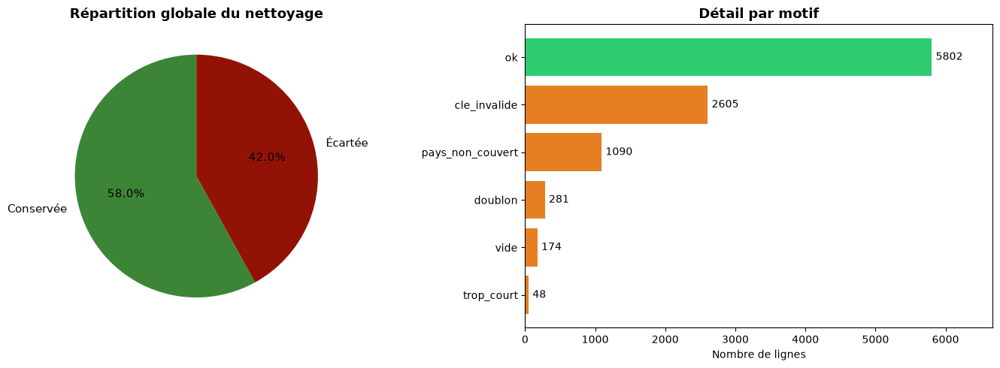
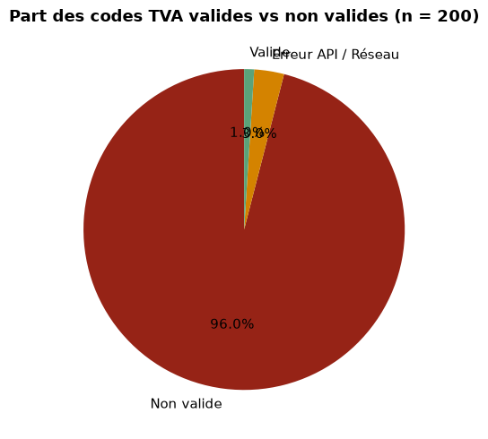

# Phase 4 — Analyser et restituer (J2 après-midi)

Produisez le **rapport de réconciliation** attendu par la direction financière : valides, invalides, non tranchés, motifs de rejet, doublons. Il doit se régénérer en relançant votre notebook d'analyse, sans manipulation manuelle.

-> Le rapport de réconciliation est produit en lançant le notebook `2.Nettoyage`

## Note à la Directrice Financière

Note de synthèse : Fiabilité des numéros de TVA intracommunautaires

Objet : Analyse de la qualité des données TVA, limites de l'échantillonnage et règles de gestion pour la facturation.
Contexte : Sur un total de 10000 lignes analysés, 42% ont été écartées dès le contrôle de format (champs vides, doublons, pays hors UE). Un échantillon de 200 numéros conformes a ensuite été vérifié auprès de la base officielle européenne VIES.

1. Origine des anomalies : où se concentrent les erreurs ?

L'analyse croisée des rejets (format et validité VIES) met en évidence des défauts d'entrée de l'information. C'est à dire que la saisie manuelle est source d'erreur : le canal le plus touché est `numero_tva`, qui compte 3917 clée non traitables, soit presque quatre clé sur dix (motifs de refus : `vide`, `trop_court`, `pays_non_couvert`, `cle_invalide`).

1. Portée des résultats : que vaut l'estimation sur 200 dossiers ?

L'échantillon de 200 numéros ayant été tiré de manière aléatoire parmi les données nettoyées, le taux d'invalidité observé de 99% constitue une estimation représentative de l'ensemble de la base. Ce chiffre est étonnant mais témoigne du fait que les données ne sont plus valides : un nombre trop grand de numéros TVA ne correspondent plus à une entreprise, qui a du fermer ou n'existe plus pour une quelconque autre raison.

1. Recommandations opérationnelles et règles de conduite

Règle de conduite pour les numéros « non tranchés » (erreurs techniques VIES)

Lorsqu'une interrogation VIES échoue pour raison technique (indisponibilité temporaire du serveur national ou délai dépassé), le dossier ne doit pas être considéré comme valide par défaut :

• Escalader au bout de 48 heures : Si le statut reste « non tranché » après deux tentatives espacées de 24 heures, le service facturation doit demander au client une attestation officielle d'assujettissement (mémento fiscal) avant toute exonération de TVA.

Durée de validité d'un verdict VIES

• Fixer une validité de 6 mois : Un numéro valide aujourd'hui peut être radié demain suite à une liquidation ou un changement de statut. Tout verdict « Valide » enregistré dans l'outil de facturation doit être recontrôlé automatiquement tous les 6 mois (ou à chaque nouvelle commande dépassant un seuil critique).

Actions préventives à la saisie

• Bloquer les erreurs à la source : Intégrer un contrôle automatique de format (longueur, préfixe pays) directement dans le formulaire de création client et supprimer les espaces avant l'enregistrement.

Bien cordialement,

Le pôle data

